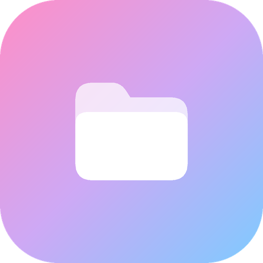

# Gryphonis

Файловый менеджер для Android на **Kotlin + Jetpack Compose** со встроенным FTP-сервером и FTP-клиентом.
Автор: **RonovaDev** · GitHub: [RonovaMain](https://github.com/RonovaMain) · пакет `dev.ronova.gryphonis`

## Возможности
- Просмотр файлов, хлебные крошки, список или сетка, миниатюры картинок, закладки, быстрый доступ, SD-карта.
- Копирование, вырезание, вставка, удаление, переименование, создание папок и файлов, ZIP (создать/распаковать).
- Окно прогресса у каждой долгой операции: проценты, скорость, **сколько осталось**, отмена.
- Разрешения запрашиваются перед любым действием с файлами.
- Поиск в папке (по желанию — вместе с подпапками).
- Сортировка: по названию, дате, типу, размеру; по возрастанию/убыванию; папки сверху.
- Показ скрытых файлов (начинаются с точки).
- Встроенные просмотрщики: текст (с правкой и сохранением), изображения (зум, листание).
- **Видеоплеер** прямо в проводнике (ExoPlayer): тап — панель, двойной тап слева/справа — ±10 секунд, скорость 0.5–2×, «вписать/заполнить», поворот экрана, переход к следующему видео в папке. Не нравится — кнопка **«Открыть в другом приложении»** в верхней панели (она же на экране ошибки, если формат не поддерживается).
- **Музыкальный плеер** с фоновым воспроизведением: уведомление-плеер (обложка, пред./пауза/след., управление с экрана блокировки и гарнитуры), перемешивание, повтор (выкл / всё / один трек), перемотка, обложка и теги. Экран плеера читаемый в любой теме и подстраивается под поворот: в альбомной ориентации обложка слева, управление справа. Список «следующих треков» спрятан в нижнюю шторку (кнопка очереди).
- **Сворачивание плеера**: стрелка вниз (или «назад») убирает полноэкранный плеер, музыка продолжает играть, внизу остаётся мини-плеер (пауза, след., закрыть). Нажатие на него или на уведомление открывает плеер снова.
- **FTP-сервер**: порт, логин, пароль, режим «только чтение», журнал, уведомление с кнопкой «Остановить».
- **FTP-клиент**: сохранённые подключения (название, адрес, порт, логин, пароль в Android Keystore, папка при входе), просмотр, **копировать → выйти → вставить** на телефон (или скачать в выбранную папку), отправка файлов, создание/удаление/переименование.
- Анализ памяти: разбивка по типам, **заход в подпапки**, выбор долгим нажатием и удаление прямо из анализа, открытие файла по нажатию.
- **Корзина** на главной: удаление по умолчанию мгновенно переименовывает файл на месте в скрытое имя `.trashed-<срок>-<имя>` (как это делает сама Android) — без копирования, без папки в данных приложения, место освобождается только после срока хранения (по умолчанию 30 дней) или очистки корзины. Галочка «Удалить насовсем?» действует на одно удаление; восстановление и очистка из корзины.
- **Архивы без распаковки** (ZIP, 7z, tar, tar.gz/tgz, tar.bz2, tar.xz, а также одиночные .gz/.bz2/.xz): тап по архиву открывает выбор — просмотреть как папку, распаковать сюда / в новую папку, открыть в другом приложении. Внутри архива файлы открываются **потоком, без распаковки и без временных файлов**: фото, видео и музыка играют прямо из архива, текст читается, **APK ставится** прямо из архива, остальное (PDF, документы…) уходит в другое приложение. Копирование выбранного (вставка в любую папку) и извлечение в выбранное место. Архивы можно открывать и из других приложений («Открыть с помощью Gryphonis»). RAR не поддерживается: для него остаётся «Открыть в другом приложении».
- **Стриминг с FTP**: тап по файлу на сервере открывает его без скачивания — фото, видео (с перемоткой), музыка, текст, а APK и документы отдаются установщику / другому приложению. Данные идут потоком по требованию, на диск телефона ничего не копируется; при обрыве соединения чтение продолжается с того же байта.
- **Анимации**: экраны (плееры, настройки, корзина, архив…) плавно выезжают и уходят, список папки анимирует появление/исчезновение файлов, плавное выделение, мини-плеер и кнопки появляются мягко. В строке пути слева закреплена кнопка **«Главная»** — один тап возвращает на главный экран.
- **Автообновление**: список папки обновляется сам (в том числе после возврата в приложение), а потянув вниз — вручную, как в браузере.
- **Недавние** на главном экране: список только что появившихся файлов (скачанные, снятые, скопированные, распакованные) за 24 часа / 3 / 7 / 30 дней, с фильтром по типу (фото, видео, музыка, документы, архивы, приложения) и группировкой «Сегодня / Вчера / дата». Время считается по моменту появления файла на диске, а не по «старой» дате внутри файла, поэтому скачанное с серверной датой не теряется. Файлы открываются, выделяются долгим нажатием (удалить, поделиться, копировать, вырезать, свойства), а кнопка **«Показать в папке»** открывает нужную папку, прокручивает список к файлу и подсвечивает его.
- **Что играет сейчас**: трек, который играет (или стоит на паузе) в плеере, в любом списке выделен цветом названия и «эквалайзером» поверх обложки — после сворачивания плеера его сразу видно в папке. В полноэкранном плеере в меню есть «Показать в папке».
- **Миниатюры**: обложки музыки (из тегов файла, а если их нет — cover.jpg / folder.jpg рядом) и иконки приложений для .apk, .apks, .xapk, .apkm. Грузятся в фоне, кэш небольшой (иконки — крошечные PNG в кэше приложения до нескольких МБ). Включаются тем же переключателем миниатюр в настройках.
- **Быстрый доступ настраивается**: Настройки → Главный экран. Можно полностью выключить блок, выбрать любые папки (в том числе свои, через встроенный выбор папки), расставить их по порядку стрелками вверх/вниз, убрать лишние и вернуть стандартные. Папку можно добавить и прямо из проводника: меню «⋮» → «В быстрый доступ».
- Контрольная сумма SHA-256, свойства файла.
- **Установка составных пакетов**: `.apks` (bundletool / SAI), `.xapk` и `.apkm` ставятся прямо из проводника — из пакета выбираются только части, подходящие устройству (ABI, плотность экрана, язык), и отдаются системному установщику одной сессией. Данные игр (OBB) из XAPK копируются в `Android/obb`. Работает и для пакетов внутри архивов и на FTP (на время установки пакет временно копируется в кэш и сразу удаляется). Нужно разрешение «Установка неизвестных приложений» — приложение само откроет его настройку.
- **Темы оформления**: по умолчанию тёмная пепельная с коралловым акцентом (светлая — кремово-жёлтая с коралловым); фирменная розово-небесная «радуга» с переливами — отдельная тема **Gryphonis**; однотонные темы без градиентов (Океан, Лес, Фиалка, Роза, Янтарь, Графит), в которых папки и значки файлов окрашены в один цвет. Выбор — Настройки → Тема оформления.
- Настройки: светлая/тёмная/системная, цветовая схема, динамические цвета, скрытые файлы, сортировка, подтверждение удаления, «О приложении».

## Поддержать проект
[Boosty](https://boosty.to/ronovamain/donate)

## FTP с компьютера
Откройте **FTP-сервер** (Главная → Инструменты), задайте порт (по умолчанию 2121), логин и пароль, нажмите «Запустить».
На ПК в той же сети введите в адресной строке проводника Windows адрес вида `ftp://192.168.1.50:2121` или используйте FileZilla.
Работает и через точку доступа телефона. Шифрование (FTPS) не поддерживается — используйте в доверенной сети.