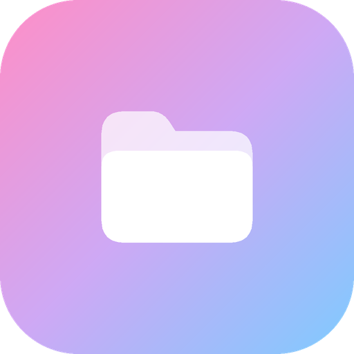

# Gryphonis

Файловый менеджер для Android на **Kotlin + Jetpack Compose** со встроенным FTP-сервером и FTP-клиентом.
Автор: **RonovaDev** · GitHub: [RonovaMain](https://github.com/RonovaMain) · пакет `dev.ronova.gryphonis`

## Возможности
- Просмотр файлов, хлебные крошки, список или сетка, миниатюры картинок, закладки, быстрый доступ, SD-карта.
- Копирование, вырезание, вставка, удаление, переименование, создание папок и файлов, ZIP (создать/распаковать).
- Окно прогресса у каждой долгой операции: проценты, скорость, **сколько осталось**, отмена.
- Разрешения запрашиваются перед любым действием с файлами.
- Поиск в папке (по желанию — вместе с подпапками).
- Сортировка: по названию, дате, типу, размеру; по возрастанию/убыванию; папки сверху.
- Показ скрытых файлов (начинаются с точки).
- Встроенные просмотрщики: текст (с правкой и сохранением), изображения (зум, листание), аудиоплеер (обложка, плейлист папки).
- **FTP-сервер**: порт, логин, пароль, режим «только чтение», журнал, уведомление с кнопкой «Остановить».
- **FTP-клиент**: подключение к серверу, просмотр, скачивание в выбранную папку, отправка файлов, создание/удаление/переименование.
- Анализ памяти: разбивка по типам, самые большие папки и файлы.
- Контрольная сумма SHA-256, свойства файла.
- Настройки: тема (светлая/тёмная/системная), динамические цвета, скрытые файлы, сортировка, подтверждение удаления, «О приложении».